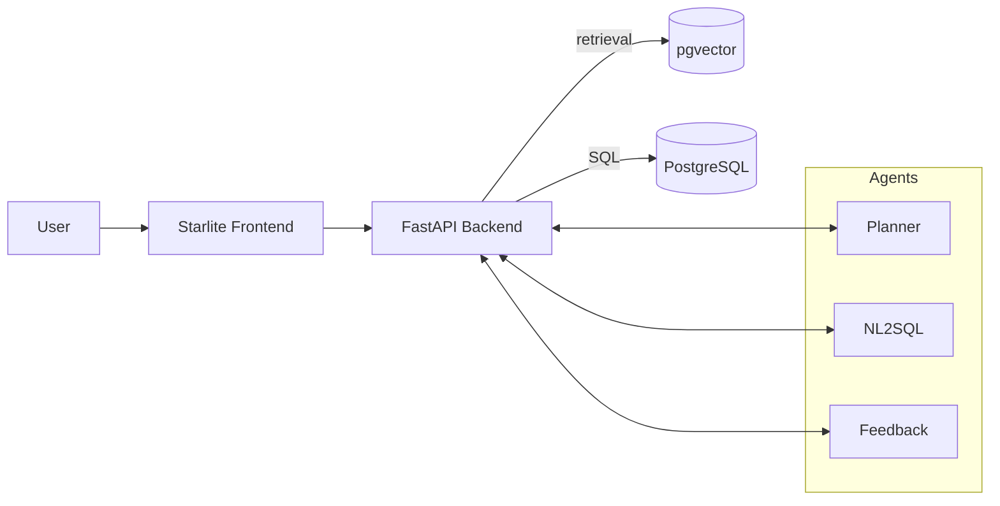

# NL2SQL with LangGraph

A proof of concept for querying PostgreSQL in natural language
and turning query results into reports.

## The problem

Answering a business question from a relational database requires
understanding its schema and writing SQL. This project explores
a workflow where users ask questions in English or Spanish,
inspect the generated query and view the results through a web interface.

## Approach

The application combines retrieval of database context with an
agent workflow for planning, SQL generation and feedback.

A FastAPI backend connects the workflow to PostgreSQL and a
Starlite web interface. Supporting context is stored with pgvector.
The application also provides Markdown and PDF report generation.

Docker Compose packages the application and its supporting services
for local experimentation.

## Engineering scope

The repository brings together:

- Agent orchestration with LangGraph/LangChain.
- Context retrieval using PostgreSQL and pgvector.
- Backend APIs, database integration and a web interface.
- Container configuration for running the stack locally.

A legacy AutoGen prototype is retained for reference.

## Project status

This is an experimental proof of concept. Generated SQL and reports
require review, and agent feedback does not guarantee correctness.

The project should be evaluated with a controlled demonstration
database before considering use with real business data.

## Example: query the demonstration database

The repository includes a fiscal consulting demonstration dataset.
Its schema and sample records are defined in
[`20_fiscal_consulting_demo.sql`](databases/_initdb/20_fiscal_consulting_demo.sql).

**Question**

> How many offices are there in the fiscal_consulting_demo schema?

**Reference SQL**

```sql
SELECT COUNT(*) AS office_count
FROM fiscal_consulting_demo.offices;
```

**Expected result with the unmodified seed data**

| office_count |
|-------------:|
| 4 |

This expected value comes from the four office records in the seed
script. It is a reference case, not a recorded end-to-end agent run.

To validate the workflow, load the demonstration data, provide the
relevant schema context to the application and submit the question.
Compare the returned result with the reference value above.
The generated SQL may differ while producing the same result.

## How It Works

1) You ask a question in plain English/Spanish.
2) The system retrieves relevant context from your vector store (pgvector).
3) Agents plan, draft SQL, and self‑review the query.
4) The backend executes SQL against Postgres and shows the results in the UI.
5) Optionally, generate a polished Markdown/PDF report summarizing insights.




## Quickstart (Docker Compose) 🐳

Prereqs: Docker Desktop or Docker Engine + Compose.

1) Create your env file
   - Copy `.env.example` to `.env` and set `OPENAI_API_KEY`.
2) Start the stack
   - `./architecture/start_all.sh up`
3) Open the apps
   - Frontend: `http://localhost:3000`
   - Backend health: `http://localhost:8001/healthz`
   - pgAdmin (optional): `http://localhost:5050`

Stop services any time with: `./architecture/start_all.sh down`


## Running Locally (without Docker) 🛠️

Prereqs: Python 3.12, Postgres with `pgvector` extension.

- Install requirements:
  - Backend: `pip install -r requirements.txt`
  - Frontend: `pip install -r requirements/frontend.txt`
- Export env vars (or copy `.env.example` to `.env`).
- Start backend: `uvicorn api.app:app --reload --port 8001`
- Start frontend: `uvicorn starlite_app:create_app --factory --reload --port 3000`


## API Overview 🔌

- `GET /healthz` – service and DB health
- `GET /vector_databases` – list available vector tables
- `POST /compute_vectors` – embed raw text into vectors
- `POST /text_to_vectordb` – embed and store text in a pgvector table
- `POST /agents_chat` – run NL→SQL flow and return the agent messages
- `POST /execute_query` – run SQL over Postgres and return rows/columns
- `POST /generate_report` – return Markdown report
- `POST /generate_report_pdf` – return a downloadable PDF
- `POST /upload_md` – upload a Markdown file and store its embeddings
- `WS /ws/agents_chat` – streaming agent messages over WebSocket


## Project Structure 🗂️

- `src/api/` – FastAPI app, schemas and services
- `src/starlite_app/` – Starlite micro UI (templates + routes)
- `src/langchain_app/` – LangChain/LangGraph orchestration and vector store
- `databases/` – SQL for demo datasets and `pgvector` init scripts
- `architecture/` – Dockerfiles, Compose, and helper scripts
- `requirements/` – pinned dependencies for backend/frontend

Note: `src/agents_chat.py` is a legacy Autogen prototype kept for reference.


## Configuration ⚙️

Use environment variables or `.env`:

- OpenAI: `OPENAI_API_KEY`
- Models: `GPT_MODEL`, `GPT_EMBEDDING_ENGINE`
- Postgres: `POSTGRES_HOST`, `POSTGRES_PORT`, `POSTGRES_USER`, `POSTGRES_PASSWORD`, `POSTGRES_DB`
- Vector: `PGVECTOR_TABLE`, `PGVECTOR_DIMENSIONS`, `PGVECTOR_TOP_K`

See `.env.example` for a complete list and defaults.


## Development Tips 🧑‍💻

- Keep large binaries out of Git (zips, datasets). Add to `.gitignore`.
- Use the Docker stack for a consistent local environment.
- pgvector demo tables are created from `databases/_initdb/*.sql`.


## Roadmap 🗺️

- [ ] Auth and multi‑tenant databases
- [ ] Richer UI with history and saved reports
- [ ] Built‑in dataset loader and schema explorer


## License 📄

This project is released under the MIT License. See `LICENSE`.


— Enjoy exploring data with natural language! ✨
